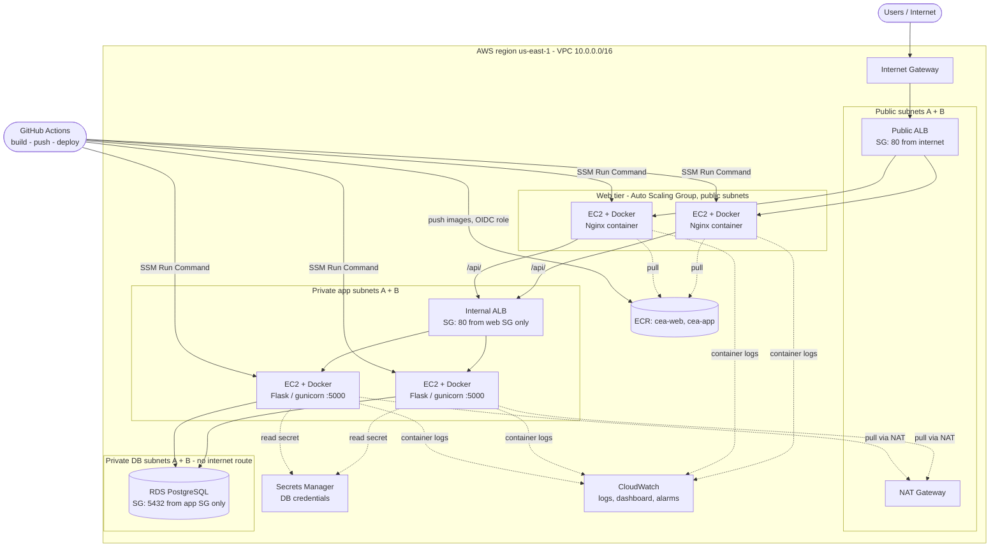

# Architecture

## Tiers
| Tier | What runs | Where | Who can reach it |
|---|---|---|---|
| Web | Nginx container: static page + reverse proxy `/api/` | Public subnets, ASG (2-3 instances) behind public ALB | Internet -> ALB only; instances accept port 80 only from the ALB security group |
| Application | Flask + gunicorn container, port 5000 | Private app subnets, ASG (2-3) behind internal ALB | Only the web tier, through the internal ALB |
| Database | RDS PostgreSQL, encrypted, not publicly accessible | Private DB subnets with no route to the internet | Only the app security group on 5432 |

## Network
- VPC 10.0.0.0/16, two Availability Zones.
- Public subnets (10.0.1/2.0): route table `0.0.0.0/0 -> Internet Gateway`.
- Private app subnets (10.0.11/12.0): route table `0.0.0.0/0 -> NAT Gateway` (outbound only, to pull images from ECR and read Secrets Manager).
- Private DB subnets (10.0.21/22.0): route table with only the local route.

## Security groups (chain of trust)
`internet -> web-alb-sg -> web-sg -> app-alb-sg -> app-sg -> db-sg`. Each group allows inbound only from the group before it.

## Secrets
The database password is generated by Secrets Manager, never written in code, Git or the template. Instances read it at runtime through their IAM role (permission for that one secret only). The pipeline has no stored AWS keys: GitHub Actions gets short-lived credentials through OIDC, and the role is limited to this repository.

## CI/CD flow
1. Push to `main`.
2. Job `test`: pytest runs the Flask tests.
3. Job `build-push-deploy`: assume the AWS role by OIDC, build both images, push `:<git-sha>` and `:latest` to ECR.
4. Deploy: SSM Run Command runs `/opt/cea/deploy.sh` on every instance tagged by tier (app first, then web). Each instance pulls `:latest` and restarts its container. The pipeline waits and fails if any instance fails.
New instances created by auto scaling run the same script at boot, so they always start on the newest image.

## Enhancements (brief requirement 9)
- Infrastructure as Code: the whole stack is one CloudFormation template.
- Logging and monitoring: container logs go to CloudWatch Logs; dashboard `cea-three-tier`; alarms for unhealthy hosts and 5xx errors.
- Cost estimate with two optimizations: see `COST.md`.
